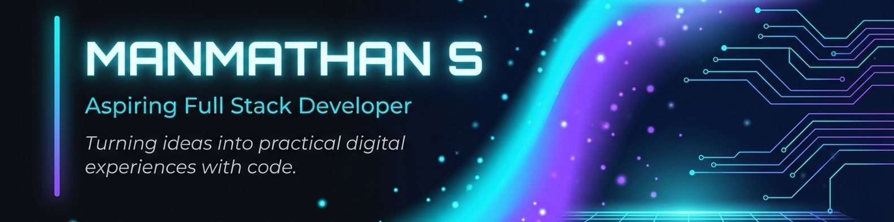
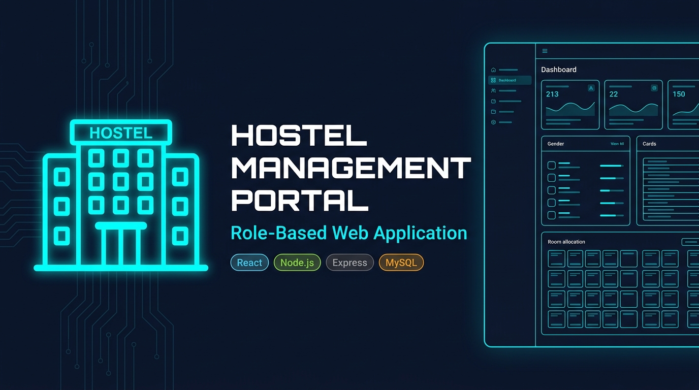
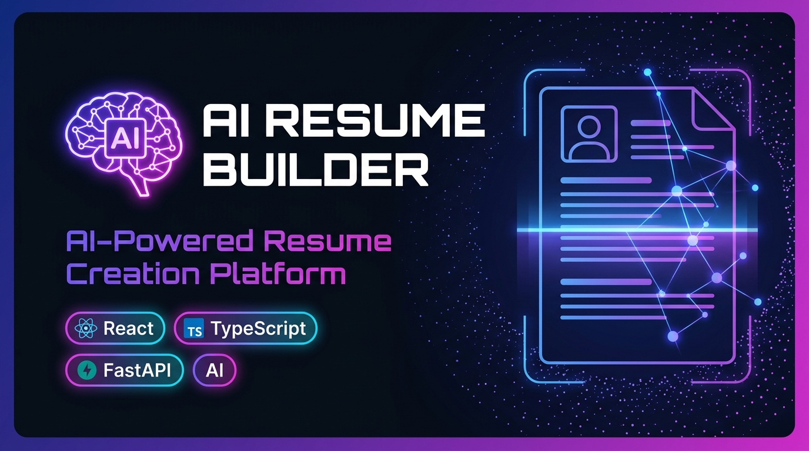
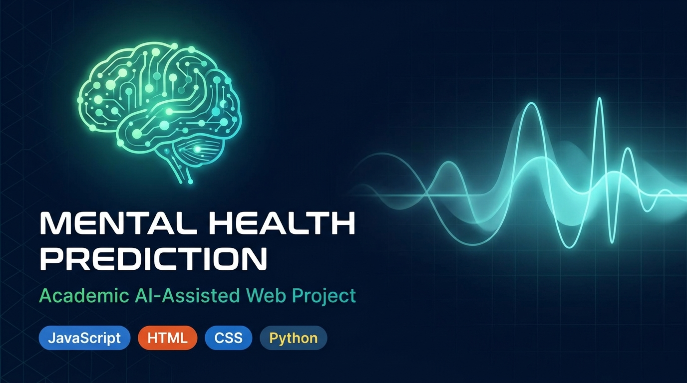

<!-- ╔══════════════════════════════════════════════════════════╗ -->
<!-- ║         MANMATHAN S — GITHUB PROFILE README             ║ -->
<!-- ║   Aspiring Full Stack Developer | Tamil Nadu, India     ║ -->
<!-- ╚══════════════════════════════════════════════════════════╝ -->

<!-- ░░░░░░░░░░░░░  HERO BANNER — FUTURISTIC HEADER  ░░░░░░░░░░░░░ -->

<picture>
  <source media="(prefers-color-scheme: dark)"  srcset="art/header-banner.jpg">
  <source media="(prefers-color-scheme: light)" srcset="https://capsule-render.vercel.app/api?type=waving&color=0:0891B2,50:6D28D9,100:22D3EE&height=150&section=header&text=MANMATHAN%20S&fontSize=52&fontColor=FFFFFF&fontAlignY=40&desc=Aspiring%20Full%20Stack%20Developer&descAlignY=62&descSize=20">
  
</picture>  

<!-- Animated Typing SVG -->
<p align="center">
  <a href="https://readme-typing-svg.demolab.com">
    
  </a>
</p>

<!-- Profile Badges Row -->
<p align="center">
  <a href="https://github.com/manmathan6305">
    
  </a>&nbsp;
  &nbsp;
  <a href="https://manmathan-portfolio.vercel.app/">
    
  </a>&nbsp;
  
</p>

<!-- Social Links -->
<p align="center">
  <a href="https://github.com/manmathan6305">
    
  </a>&nbsp;
  <a href="https://www.linkedin.com/in/manmathan6305">
    
  </a>&nbsp;
  <a href="https://leetcode.com/u/manmathan6305/">
    
  </a>&nbsp;
  <a href="https://manmathan-portfolio.vercel.app/">
    
  </a>
</p>

---

## About Me

<table>
<tr>
<td width="60%" valign="top">

<br/>

```yaml
name     : Manmathan S
title    : Aspiring Full Stack Developer
degree   : B.Tech — Computer Science & Business Systems
college  : Bannari Amman Institute of Technology
grad_yr  : 2027
location : Tamil Nadu, India
focus    : Full Stack Web Development
status   : Open to Internships & Opportunities
```

<br/>

**Currently building** full-stack applications with modern web technologies

**Actively learning** advanced backend patterns, APIs and AI integrations

**Passionate about** solving real-world problems with practical software

**Career goal** - Skilled Software Engineer contributing to impactful products

**Sharpening** Data Structures, Algorithms and OOP foundations daily

<br/>

</td>
<td width="40%" align="center" valign="middle">

<br/>


<br/>
<sub><b>Replace art/profile-photo.jpg with your actual photograph</b></sub>

<br/><br/>

</td>
</tr>
</table>


---

## Tech Stack

<details open>
<summary><b>Programming Languages</b></summary>
<br/>
<p align="center">
  
</p>
<p align="center">
  
  
  
  
  
</p>
<br/>
</details>

<details open>
<summary><b>Frontend Development</b></summary>
<br/>
<p align="center">
  
</p>
<p align="center">
  
  
  
  
  
</p>
<br/>
</details>

<details open>
<summary><b>Backend and Databases</b></summary>
<br/>
<p align="center">
  
</p>
<p align="center">
  
  
  
  
  
  
</p>
<br/>
</details>

<details open>
<summary><b>Tools and Platforms</b></summary>
<br/>
<p align="center">
  
</p>
<p align="center">
  
  
  
  
  
</p>
<br/>
</details>

<details open>
<summary><b>Core Fundamentals</b></summary>
<br/>
<p align="center">
  
  
</p>
<p align="center">
  
  
</p>
<br/>
</details>


---

## Featured Projects

<a href="https://github.com/MANMATHAN6305/Hostal_Management_Portal">
  
</a>

<table>
<tr>
<td width="70%" valign="top">

### Hostel Management Portal

> *A comprehensive role-based hostel management system for academic institutions*

**What it does:**
- Multi-role dashboards — Admin, Warden and Student portals
- Room allocation and hostel operations management
- Mess menu, complaints, leave and room-change request workflows
- Payment records, visitor management and gate logs
- Full MySQL database integration with Sequelize ORM

</td>
<td width="30%" align="center" valign="top">
<br/>

**Tech Stack**


<br/>

[](https://github.com/MANMATHAN6305/Hostal_Management_Portal)

[](https://hostal-management-portal.onrender.com/login)

</td>
</tr>
</table>

<br/>

<a href="https://github.com/MANMATHAN6305/RealAIResumeBuilder">
  
</a>

<table>
<tr>
<td width="70%" valign="top">

### AI Resume Builder

> *An AI-assisted resume creation platform with smart structuring*

**What it does:**
- AI-powered resume generation with structured content guidance
- A4 resume preview and PDF export functionality
- Modern React/TypeScript interface with smooth UX
- Backend API integration for AI processing
- Clean, professional resume templates

</td>
<td width="30%" align="center" valign="top">
<br/>

**Tech Stack**


<br/>

[](https://github.com/MANMATHAN6305/RealAIResumeBuilder)

</td>
</tr>
</table>

<br/>

<a href="https://github.com/MANMATHAN6305/Mental_Health_Prediction">
  
</a>

<table>
<tr>
<td width="70%" valign="top">

### Mental Health Prediction

> *Academic web project exploring AI-assisted mental health awareness*

**What it does:**
- Interactive web interface for user wellness input
- Prediction-oriented workflows with visual feedback
- Deployed web application with clean frontend design
- Raises awareness around mental health through technology

</td>
<td width="30%" align="center" valign="top">
<br/>

**Tech Stack**


<br/>

[](https://github.com/MANMATHAN6305/Mental_Health_Prediction)

</td>
</tr>
</table>


---

## Experience and Certifications

<table>
<tr>
<td width="50%" valign="top">

### Work Experience

**Frontend / Full Stack Developer Intern**
Crayon'D — Remote
March – May 2025

- Built and maintained frontend and full-stack features
- Collaborated with a 5-member development team
- Worked on production web application workflows

</td>
<td width="50%" valign="top">

### Certifications

- **Oracle Java SE 17** — Java Certification
- **HackerRank** — Java (Basic)
- **HackerRank** — Frontend Developer (React)
- **IBM SkillsBuild** — Web Development Fundamentals

</td>
</tr>
</table>


---

## GitHub Analytics

<p align="center">
  
  &nbsp;&nbsp;
  
</p>

<p align="center">
  
</p>

<p align="center">
  
</p>


---

## Contribution Snake

<p align="center">
  <picture>
    <source media="(prefers-color-scheme: dark)"  srcset="https://raw.githubusercontent.com/manmathan6305/manmathan6305/output/github-contribution-grid-snake-dark.svg">
    <source media="(prefers-color-scheme: light)" srcset="https://raw.githubusercontent.com/manmathan6305/manmathan6305/output/github-contribution-grid-snake.svg">
    
  </picture>
</p>

> Setup required: Push this repo to GitHub and enable Actions. Run the Generate Snake workflow manually once to generate the snake SVG on the output branch.


---

## Coding Profiles

<p align="center">
  <a href="https://leetcode.com/u/manmathan6305/">
    
  </a>&nbsp;
  <a href="https://www.hackerrank.com/profile/manmathan6305">
    
  </a>&nbsp;
  <a href="https://www.geeksforgeeks.org/user/manmathan6305/">
    
  </a>
</p>


---

## Connect and Collaborate

<p align="center">
  <a href="https://www.linkedin.com/in/manmathan6305">
    
  </a>&nbsp;
  <a href="https://github.com/manmathan6305">
    
  </a>&nbsp;
  <a href="https://manmathan-portfolio.vercel.app/">
    
  </a>&nbsp;
  <a href="mailto:manmadhansiva2005@gmail.com">
    
  </a>
</p>

<p align="center">
  I'm always open to exciting projects, collaborations, and internship opportunities.<br/>
  Feel free to reach out — let's build something meaningful together!
</p>

---

<p align="center">
  <b>Learn and Build and Improve and Repeat</b>
</p>

<p align="center">
  
</p>
