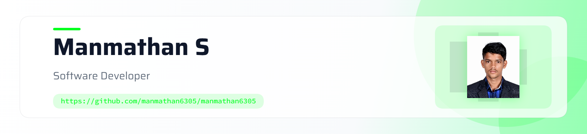

 <!-- Profile Header -->
<picture>
   <source media="(prefers-color-scheme: dark)" srcset="art/header-dark.png">
   
</picture>

  

<h1 align="center">Hey there, I'm Manmathan S 👋</h1>

<h3 align="center">
  B.Tech CSBS Student | Full Stack Developer | Java Programmer
</h3>

  

  
  
  

---

## 👨‍💻 About Me

<table>
<tr>
<td width="65%" valign="top">

- 🎓 Pursuing **B.Tech in Computer Science and Business Systems (CSBS)** at Bannari Amman Institute of Technology.
- 💻 Interested in **Full Stack Development and Software Engineering**.
- ☕ Working with Java, JavaScript, React.js, Node.js, and SQL.
- 🗄️ Interested in database design, REST APIs, and backend development.
- 🚀 Building practical applications that solve real-world problems.
- 🤖 Exploring AI-powered applications and API integrations.
- 📚 Improving my Data Structures, Algorithms, OOP, and problem-solving skills.
- 🎯 Career goal: Become a skilled Software Engineer and contribute to impactful products.

</td>
<td width="35%" align="center" valign="middle">

</td>
</tr>
</table>

## 🛠️ Tech Stack

### Programming Languages

  

### Frontend Development

  

### Backend Development & Databases

  

### Tools & Platforms

  

### Core Concepts

  
  
  
  
  

## 🚀 Featured Projects

### 1. 🏢 Visitor Management System

A role-based visitor management application designed for college and company environments.

- 👥 Roles: Admin, Security, Host Employee, and Visitor.
- ✅ Visitor registration and host approval workflows.
- 📱 QR-based visitor passes and gate entry/exit verification.
- 🔐 Role-based access control and blacklist management.
- 📊 Visitor records, gate logs, and reporting.

**Focus:** Full-stack development, authentication, authorization, database management, and QR verification.

### 2. 🏠 Hostel Management Portal

A web application for managing hostel operations and student services.

- 👨‍💼 Admin, Warden, and Student dashboards.
- 🛏️ Room allocation and hostel management.
- 🍽️ Mess menu, complaints, leave requests, and room-change requests.
- 💳 Payment records and visitor management.
- 🗄️ MySQL database integration.

**Tech Stack:** React.js, Vite, Node.js, Express.js, MySQL, Sequelize.

[🔗 View Repository](https://github.com/MANMATHAN6305/Hostal_Management_Portal) · [🌐 Live Demo](https://hostal-management-portal.onrender.com/login)

### 3. 🤖 AI Resume Builder

An AI-powered resume-building project focused on helping users create professional resumes.

- 📝 Resume creation and editing.
- 📄 A4 resume preview and PDF export.
- ⚡ Modern React-based interface.
- 🔌 Backend API integration.

**Tech Stack:** React, TypeScript, Vite, FastAPI, AI API integration.

[🔗 View Repository](https://github.com/MANMATHAN6305/RealAIResumeBuilder)

### 4. 🧠 Mental Health Prediction

A web-based project focused on presenting a mental-health-related prediction application.

- 🖥️ Interactive web interface.
- 📊 User input and prediction-oriented workflow.
- 🌐 Web deployment and frontend development practice.

**Focus:** Web development, JavaScript, and application design.

[🔗 View Repository](https://github.com/MANMATHAN6305/Mental_Health_Prediction)

## 💼 Experience & Certifications

- **Full Stack / Frontend Developer Intern — Crayon'D**  
  March–May 2025 · Remote  
  Worked on frontend and full-stack development tasks and collaborated with a five-member team.

- **Oracle Java SE 17 Certification**
- **HackerRank Java (Basic)**
- **HackerRank Frontend Developer (React)**
- **IBM SkillsBuild Web Development Fundamentals**

## 📈 GitHub Analytics

  
  

  

  

## 🐍 Contribution Snake

  

## 🏆 Coding Profiles

  
  
  

## 🌐 Let's Connect

  
  
  
  

---

  💡 <b>Learn. Build. Improve. Repeat.</b>

  Thanks for visiting my profile! Let's build something meaningful together. 🚀

  

   